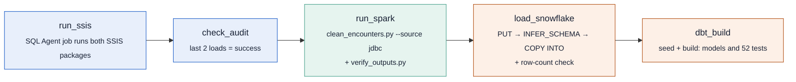
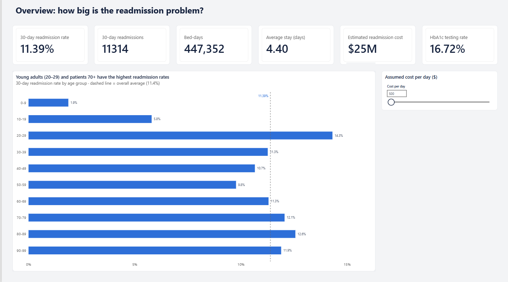
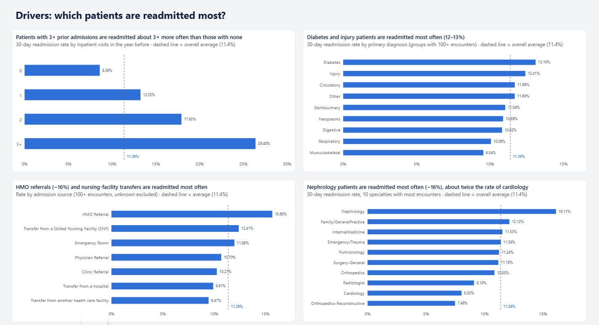
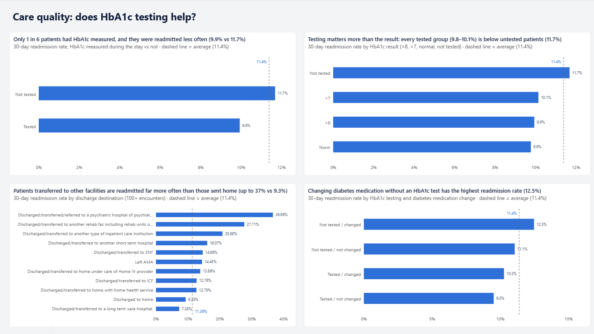
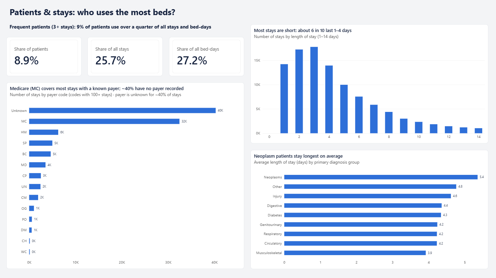
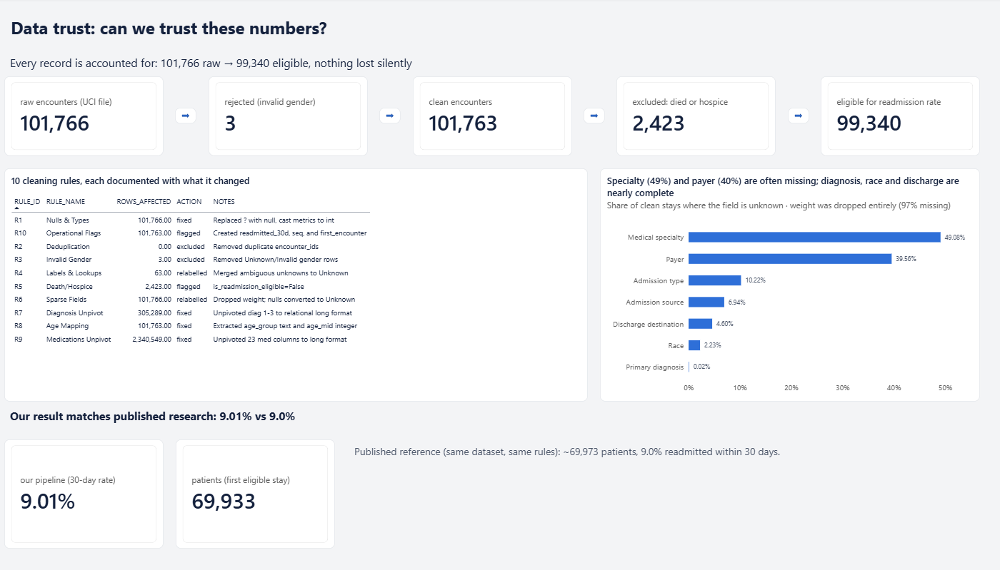
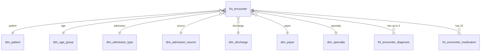

<p align="center">
  
</p>

<p align="center">
  
  
  
  
  
  
  
  
</p>

<p align="center">
  <b>Which diabetic patients come back to hospital within 30 days, and what can a hospital do about it?</b><br>
  An end-to-end, fully automated data pipeline that turns 101,766 messy hospital records into a trusted Power BI dashboard, with one click.
</p>

---

## Contents

- [Highlights](#highlights)
- [The business problem](#the-business-problem)
- [Architecture](#architecture)
- [The pipeline, stage by stage](#the-pipeline-stage-by-stage)
- [Data quality: what we found and fixed](#data-quality-what-we-found-and-fixed)
- [Key findings](#key-findings)
- [Dashboard](#dashboard)
- [Data model](#data-model)
- [How we know the numbers are right](#how-we-know-the-numbers-are-right)
- [Repository structure](#repository-structure)
- [Getting started](#getting-started)
- [Team](#team)
- [Limitations and next steps](#limitations-and-next-steps)
- [Dataset and credits](#dataset-and-credits)

---

## Highlights

<p align="center">
  
</p>

- **Zero rows lost.** Every stage reconciles its row counts, or the run stops.
- **Matches published research.** On the study's own definition we get 9.01% (69,933 patients) against ~9.0% (~69,973 patients) in [Strack et al. (2014)](https://doi.org/10.1155/2014/781670).
- **Fully automated.** Airflow runs SSIS → audit check → Spark → Snowflake → dbt in one click, in 7 min 46 s.
- **Tested at every layer.** 15 ingestion health checks, pytest unit tests on the cleaning rules, and 52 dbt tests.

---

## The business problem

A patient who returns within 30 days of discharge counts against the hospital. In the US, hospitals with too many readmissions lose **up to 3% of their Medicare payments** (HRRP), and diabetic patients are a high-risk group.

Hospital management asked five questions:

| # | Question | Where it is answered |
| --- | --- | --- |
| 1 | How big is our readmission problem? | Dashboard page 1 · Overview |
| 2 | Which patients drive it? | Dashboard page 2 · Drivers |
| 3 | Does better diabetes care help? | Dashboard page 3 · Care quality |
| 4 | Who uses our beds? | Dashboard page 4 · Patients & stays |
| 5 | Can we trust these numbers? | Dashboard page 5 · Data trust |

**Why batch, not streaming:** a readmission is only known 30 days after discharge, so daily or monthly reporting fits the question.

---

## Architecture

<p align="center">
  
</p>

The Airflow DAG `readmissions_pipeline` (manual trigger, 1 retry per task):



---

## The pipeline, stage by stage

| Stage | Owner | Tools | What it does | Output | Built-in check |
| --- | --- | --- | --- | --- | --- |
| **1 · Ingestion + profiling** | Shahd Galal | SSIS, SQL Server 2025, C# | Loads both CSVs into staging unchanged (all text, `?` stays `?`); audits every run; profiles 10 quality issues | `stg` tables, [Data Issues Register](docs/issues_register.md) | rows read = rows written, 15 health checks |
| **2 · Cleaning** | Yamen Ehab | PySpark | Applies 10 cleaning rules (R1–R10), splits diagnoses and medications into long tables | Parquet: encounters, diagnoses, medications, lookups, rejected, dq_summary | raw = clean + rejected, pytest, benchmark |
| **3 · Warehouse + model** | Abdullah Ahmed | Snowflake, dbt | Loads Parquet to RAW, builds staging → star schema → marts | `ANALYTICS` schema | Snowflake row counts, 52 dbt tests |
| **4 · Dashboard** | Abdullah Ahmed | Power BI | 5-page report for hospital management | [`dashboard/charts.pbix`](dashboard/charts.pbix) | Data-trust page |
| **Orchestration** | Abdullah Ahmed | Airflow in Docker | Runs everything in order, stops on any failed check | One DAG | Task-level checks |

<details>
<summary><b>Stage 1 in detail: SSIS ingestion</b></summary>

<br>

- **Two packages:** `load_encounters.dtsx` (101,766 visits) and `load_id_mappings.dtsx` (63 codes).
- **Each package runs 3 steps:** *Start audit* (empty staging, log the run as `running`) → *Load* (good rows to `stg`, bad rows to `etl.load_errors`) → *Close audit* (rows read, rows written, `success`).
- **An error path** means one broken row can never crash the load. An `OnError` handler marks the run `failed` instead of leaving it stuck on `running`.
- **The mapping file** holds 3 tables stacked in one CSV. A C# Script Component splits and tags each line: 68 lines → 63 real codes.
- **Deployed to SSISDB** with logging on. `ingestion/run_ssis_packages.sql` starts both packages synchronously.
- **Security:** Spark connects with a read-only login, so it can read staging but never change it.
- **Result:** 101,766 read = 101,766 written · 0 bad rows · `load_encounters` 14.5 s · `load_id_mappings` 4.7 s.

</details>

<details>
<summary><b>Stage 2 in detail: the 10 cleaning rules</b></summary>

<br>

| Rule | What it does | Rows affected |
| --- | --- | ---: |
| R1 · Nulls & types | `?` → NULL, cast numbers; HbA1c `None` → "Not tested" | 101,766 |
| R2 · Deduplication | Unique `encounter_id` check | 0 |
| R3 · Invalid gender | Rejected and kept in `rejected` for audit | 3 |
| R4 · Labels & lookups | Parse stacked mapping; 4 "unknown" labels → one "Unknown" | 65 |
| R5 · Death / hospice | `is_readmission_eligible = false` (codes 11, 13, 14, 19, 20, 21) | 2,423 |
| R6 · Sparse fields | Drop `weight` (97% missing); NULL → "Unknown" | 101,766 |
| R7 · Diagnosis unpivot | 3 diagnosis columns → 1 row each, ICD-9 groups | 303,487 |
| R8 · Age mapping | `[70-80)` → "70-79" and midpoint 75 | 101,763 |
| R9 · Medications unpivot | 23 medicine columns → long format | 2,340,549 |
| R10 · Flags | `readmitted_30d`, visit sequence, first-visit flag | 101,763 |

Full report: [docs/cleaning_report.md](docs/cleaning_report.md)

</details>

---

## Data quality: what we found and fixed

The raw file looked complete, but profiling found **10 hidden problems**. Each one became a cleaning rule.

| # | Problem | Measured | Why it matters |
| --- | --- | --- | --- |
| 1 | Missing values stored as `?` | 7 columns; weight 97% missing | Gaps look like real data |
| 2 | Very sparse fields | Specialty 49%, payer 40% missing | Some questions can't be answered |
| 3 | Codes without labels | 63 codes in a stacked file | IDs are unreadable without them |
| 4 | Many ways to say "unknown" | 4 labels, same meaning | Splits one group into four |
| 5 | **Died or went to hospice** | **2,423 visits** | They can never be readmitted, so including them makes the rate look better than it is |
| 6 | Repeat patients | 101,766 rows, 71,518 patients | Counting rows as patients overstates patients by 42% |
| 7 | `None` means "not tested" | 83% never tested for HbA1c | Treated as missing, most patients vanish from the care-quality question |
| 8 | Raw diagnosis codes | 916 distinct codes | Too many to analyse without grouping |
| 9 | Invalid values | 3 invalid genders; age as text | Breaks filters and charts |
| 10 | Almost-empty medicine columns | 12 of 23 rarely used | Noise in the model |

<p align="center">
  
</p>

Full register with the SQL behind each number: [docs/issues_register.md](docs/issues_register.md)

---

## Key findings

> **1 in 9 eligible hospital stays leads to a readmission within 30 days:** 11.4%, or 11,314 readmissions and 447,352 bed-days.

| Finding | Number |
| --- | --- |
| **Past admissions are the strongest warning sign** | 26.4% readmitted with 3+ prior admissions vs 8.6% with none (3× as often) |
| Risk does not simply rise with age | Ages 20–29 highest (14.3%); ages 50–59 lowest adult group (9.8%) |
| Diagnosis matters less than history | Nephrology 16.1%, twice cardiology's 8.0%; most groups 9.5–13.1% |
| Better diabetes care is linked to fewer readmissions | Tested for HbA1c 9.9% vs not tested 11.7%; only 16.7% tested |
| Transfers come back far more often | Psychiatric 36.7%, rehab 27.7%, left against advice 14.5%, home 9.3% |
| A few patients use many beds | 8.9% of patients have 3+ stays: 25.7% of stays and 27.2% of bed-days |

**Our four recommendations to hospital management:**

1. **Flag repeat patients:** extra discharge planning and a follow-up call for patients with 2+ admissions in the past year.
2. **Measure before changing treatment:** make an HbA1c test standard before adjusting diabetes medication; only 1 in 6 is tested today.
3. **Strengthen handovers:** a structured handover for transfers and for patients leaving against advice.
4. **Fix data capture:** record specialty and payer on every stay (49% and 40% missing today).

---

## Dashboard

The Power BI report ([`dashboard/charts.pbix`](dashboard/charts.pbix)) has 5 pages, one for each management question.

**Page 1 · Overview: how big is the readmission problem?**

<p align="center">
  
</p>

<table>
  <tr>
    <td width="50%"><b>Page 2 · Drivers: which patients are readmitted most?</b><br><br></td>
    <td width="50%"><b>Page 3 · Care quality: does HbA1c testing help?</b><br><br></td>
  </tr>
  <tr>
    <td width="50%"><b>Page 4 · Patients &amp; stays: who uses the most beds?</b><br><br></td>
    <td width="50%"><b>Page 5 · Data trust: can we trust these numbers?</b><br><br></td>
  </tr>
</table>

> The estimated readmission cost uses an adjustable cost-per-day slider, because the real cost per bed-day is an assumption (see [Limitations](#limitations-and-next-steps)).

---

## Data model

dbt builds three layers in Snowflake: **staging** (`stg_*`) → **core star schema** (`dim_*`, `fct_*`) → **marts** (`mart_*`) for the dashboard.



| Mart | Feeds |
| --- | --- |
| `mart_readmission_kpis` | Headline KPIs |
| `mart_readmission_by_segment` | Rates by age, history, diagnosis, discharge |
| `mart_a1c_impact` | HbA1c testing vs readmission |
| `mart_frequent_patients` | Repeat patients and bed use |
| `mart_length_of_stay` | Length of stay |
| `mart_unknown_share` | Missing-data share per field |
| `mart_data_trust` | Reconciliation and benchmark |

---

## How we know the numbers are right

| Layer | Check | Result |
| --- | --- | --- |
| Ingestion | Audit table: rows read = rows written | 101,766 = 101,766, 0 bad rows |
| Ingestion | `ingestion/verify_ingestion.sql`: 15 health checks | 15 / 15 pass |
| Airflow | `check_audit`: last two loads succeeded | Stops the run otherwise |
| Cleaning | Raw = clean + rejected | 101,766 = 101,763 + 3 |
| Cleaning | pytest on the rules · `scripts/verify_outputs.py` | Pass |
| Snowflake | Row count in Snowflake = rows in Parquet | Match for all 6 tables |
| dbt | 52 tests incl. reconciliation, eligible count, benchmark range | 52 / 52 pass |
| Benchmark | First visit per patient, eligible discharges | 9.01% vs ~9.0% published |

---

## Repository structure

```text
Diabetes_Readmissions_Analytics_Data_Engineering/
├── airflow/                    Orchestration (Leader)
│   ├── dags/readmissions_pipeline.py   The 5-task DAG
│   ├── Dockerfile              Airflow + Java + JDBC driver + dbt
│   └── docker-compose.yaml     Postgres, webserver (port 8081), scheduler
├── ingestion/                  Stage 1 (Member A)
│   ├── ReadmissionsIngestion/  SSIS project: load_encounters, load_id_mappings
│   ├── create_staging_tables.sql
│   ├── profiling.sql           One query per quality issue
│   ├── run_ssis_packages.sql   Starts both packages from SSISDB
│   └── verify_ingestion.sql    15 health checks
├── cleaning/                   Stage 2 (Member B)
│   ├── clean_encounters.py     Spark job (--source csv | jdbc, --sample)
│   ├── rules.py                Rules R1–R10
│   └── tests/test_rules.py     pytest
├── warehouse/                  Stage 3 (Leader)
│   ├── load_snowflake.py       Parquet → Snowflake RAW
│   └── dbt_project/            staging → core → marts, tests, seeds
├── dashboard/charts.pbix       Power BI report
├── scripts/verify_outputs.py   Checks the cleaning outputs
├── data/
│   ├── raw/                    Full dataset (not in Git, download from UCI)
│   ├── sample/                 5,000-row sample for development
│   └── processed/              Pipeline output (not in Git)
├── docs/                       Issues register, cleaning report
└── requirements.txt
```

---

## Getting started

<details>
<summary><b>1. Prerequisites</b></summary>

<br>

- Windows with **SQL Server 2025 Developer** (with Integration Services), **SSMS**, and **Visual Studio** with the SSIS extension
- **Python 3.11**, **Java 17** (for Spark)
- **Docker Desktop** (for Airflow)
- A **Snowflake** account with key-pair authentication
- **Power BI Desktop**

</details>

<details>
<summary><b>2. Get the code and data</b></summary>

<br>

```bash
git clone https://github.com/abdullah-attia/Diabetes_Readmissions_Analytics_Data_Engineering.git
cd Diabetes_Readmissions_Analytics_Data_Engineering
pip install -r requirements.txt
```

Download the [UCI dataset 296](https://archive.ics.uci.edu/dataset/296) and put `diabetic_data.csv` and `IDs_mapping.csv` in `data/raw/`. No full data? Use `data/sample/` and the `--sample` flag.

</details>

<details>
<summary><b>3. Stage 1: SQL Server and SSIS</b></summary>

<br>

1. In SSMS, run `ingestion/create_staging_tables.sql` (creates `ReadmissionsStaging`, schemas `stg` and `etl`, and 4 tables).
2. Open `ingestion/ReadmissionsIngestion/ReadmissionsIngestion.slnx` in Visual Studio and set the two file-path project parameters.
3. Deploy the project to the SSIS catalog (folder `Readmissions`).
4. Create the SQL Agent job `readmissions_ingestion`, which Airflow starts. Or run `ingestion/run_ssis_packages.sql` by hand.
5. Check: run `ingestion/verify_ingestion.sql`. All 15 checks should say `PASS`.

</details>

<details>
<summary><b>4. Secrets</b></summary>

<br>

Set these as environment variables (in a local `set_env.ps1` or `airflow/.env`, both git-ignored). **Never commit them.**

| Variable | Used by |
| --- | --- |
| `STAGING_USER`, `STAGING_PASSWORD` | Spark (read-only SQL Server login) |
| `STAGING_JDBC_URL` (optional) | Spark |
| `SF_ACCOUNT`, `SF_USER`, `SF_PRIVATE_KEY_PATH` | Snowflake loader and dbt |

</details>

<details>
<summary><b>5. Run each stage by hand (optional)</b></summary>

<br>

```powershell
. .\set_env.ps1
python cleaning/clean_encounters.py --source jdbc      # or: --source csv --sample
python scripts/verify_outputs.py
pytest cleaning/tests
python warehouse/load_snowflake.py
cd warehouse/dbt_project; dbt seed --profiles-dir .; dbt build --profiles-dir .
```

</details>

<details>
<summary><b>6. Run the whole pipeline with Airflow</b></summary>

<br>

```bash
cd airflow
docker compose up -d --build
```

Open <http://localhost:8081>, unpause `readmissions_pipeline`, and click **Trigger DAG**. A full run takes about 8 minutes. Then open `dashboard/charts.pbix` and refresh.

</details>

---

## Team

| | Name | Role | Owns |
| --- | --- | --- | --- |
|  | **Abdullah Ahmed** ([@abdullah-attia](https://github.com/abdullah-attia)) | Team Leader | Snowflake, dbt, Power BI, Airflow |
|  | **Shahd Galal** ([@shahdAboelmakarm22](https://github.com/shahdAboelmakarm22)) | Member A | SSIS ingestion, SQL Server staging, data profiling |
|  | **Yamen Ehab** ([@1TheMaster1](https://github.com/1TheMaster1)) | Member B | PySpark cleaning rules, data trust |

---

## Limitations and next steps

| Limits | Next steps |
| --- | --- |
| Associations, not proof of cause | Review the findings with clinicians |
| US hospitals 1999–2008, not one specific hospital | Run the same pipeline on a hospital's own data |
| No admission dates, so no trends over time | Predict readmission risk at discharge |
| Cost per bed-day is a placeholder assumption (`seeds/cost_assumptions.csv`) | Stream daily admissions for early alerts |

---

## Dataset and credits

- **Data:** [Diabetes 130-US Hospitals for Years 1999–2008](https://archive.ics.uci.edu/dataset/296), UCI Machine Learning Repository, licensed [CC BY 4.0](https://creativecommons.org/licenses/by/4.0/). The data is anonymised.
- **Benchmark study:** Strack, B. et al. (2014). *Impact of HbA1c Measurement on Hospital Readmission Rates: Analysis of 70,000 Clinical Database Patient Records.* BioMed Research International. [doi:10.1155/2014/781670](https://doi.org/10.1155/2014/781670)

<p align="center"><sub>Built by Abdullah Ahmed, Shahd Galal and Yamen Ehab · Diabetes Readmissions Analytics</sub></p>
